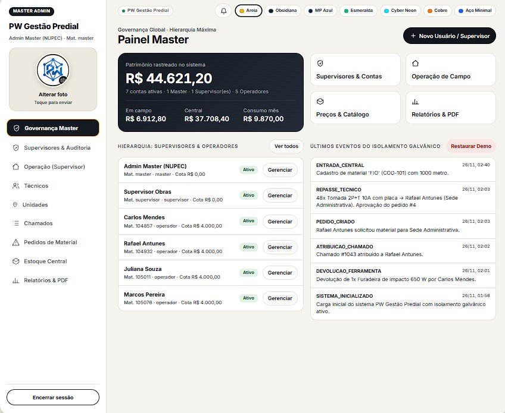
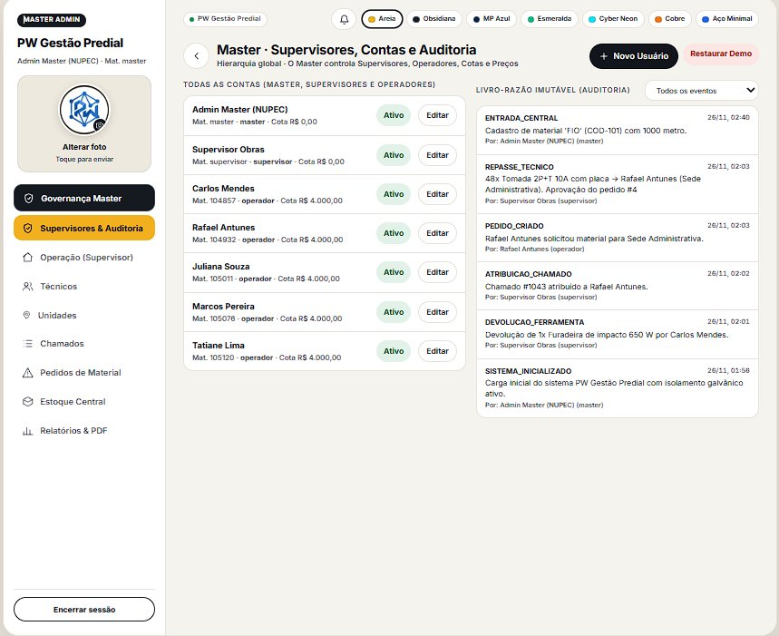
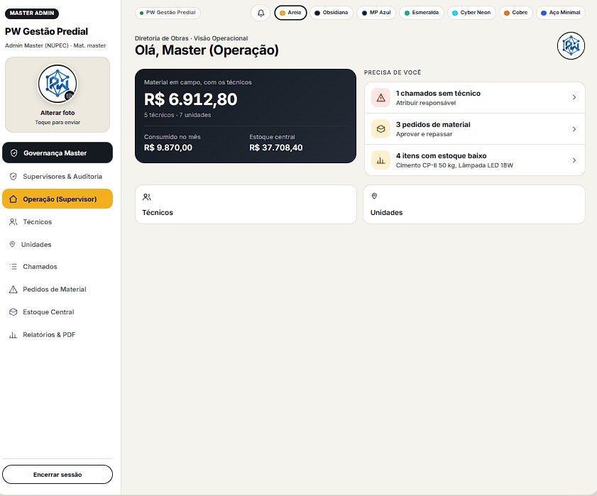
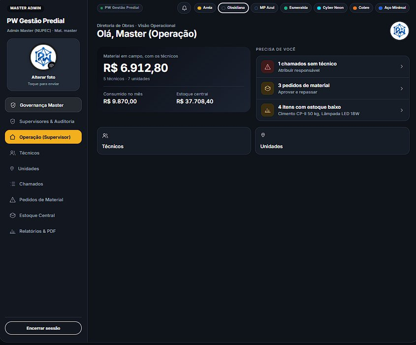
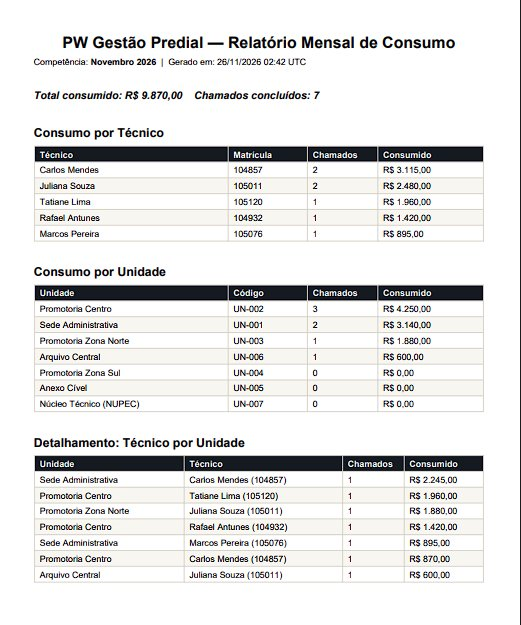

# PW Gestão Predial — Showcase

> Language / Idioma: [Português](README.md) · **English**

Enterprise platform by **PW System** for **Facilities Maintenance, Field Inventory Control, Tool Custody, Work-Order Dispatch, and Operational Auditing** across multi-site operations.

---

## Live Web Demo

Open the live presentation environment:

**[Launch PW Gestão Predial on Render](https://pw-gestao-predial.onrender.com)**

> *Note: hosted on a free-tier showcase instance; the first request after idle periods may take a few seconds to wake up.*

---

## System Screenshots

### Master Panel — Global Governance & Audit Ledger
| Global Governance & Hierarchy | Supervisors, Accounts & Immutable Ledger |
| :---: | :---: |
|  |  |

### Operational View — Light & Dark Themes
| Sand Theme | Obsidian Theme (Dark Mode) |
| :---: | :---: |
|  |  |

### Monthly Consumption Report (PDF Export)

---

## Key Capabilities

- **Role-Based Access Control:** strict separation across Master Governance, Operational Supervisors, and Field Technicians.
- **Inventory & Tool Custody:** central warehouse tracking, quota-enforced transfers, per-technician custody tracking, and item-level breakdown.
- **End-to-End Work Orders:** creation, assignment by facility/technician, execution, automatic material deduction, and real-time notifications.
- **Immutable Audit Trail:** chronological record of operational and financial movements.
- **Executive PDF Reports:** monthly rollups by technician, facility, and facility × technician matrix.
- **Customizable UI:** multiple visual themes (light, dark, and high-contrast skins) and per-user profile avatars.

---

## Intellectual Property

This repository is strictly a public showcase. Full source code and native mobile binaries remain private under **PW System** ownership.
