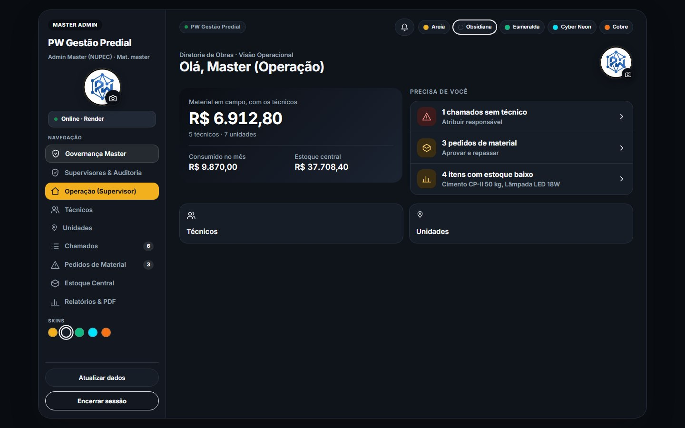
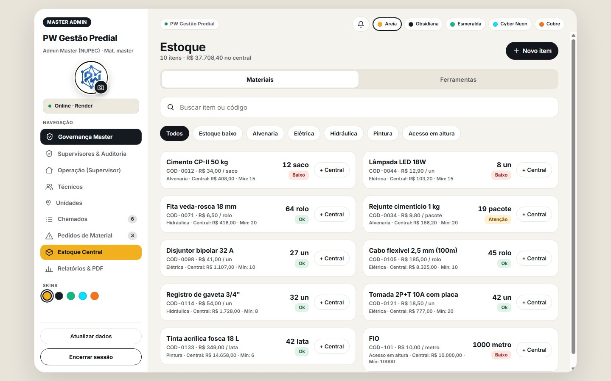
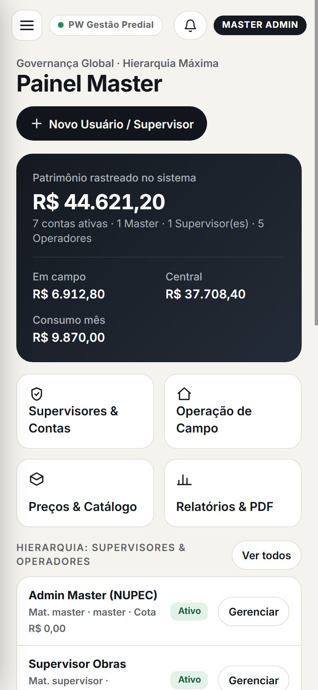
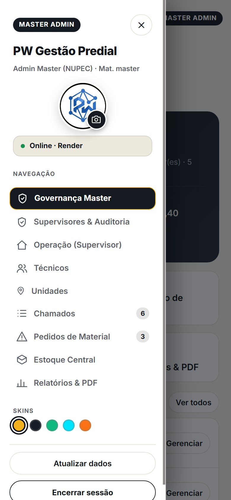

# PW Gestão Predial — Showcase

> Language / Idioma: [Português](README.md) · **English**

Enterprise platform by **PW System** for **Facilities Maintenance, Field Inventory Control, Tool Custody, Work-Order Dispatch, and Operational Auditing** across multi-site operations.

---

## Live Web Demo

Open the live presentation environment:

**[Launch PW Gestão Predial on Render](https://pw-gestao-predial.onrender.com)**

> *Note: hosted on a free-tier showcase instance; the first request after idle periods may take a few seconds to wake up.*

---

## System Screenshots

### Master Panel & Operational View (Desktop)
| Master Governance (Sand Theme) | Operational View (Obsidian Dark Mode) |
| :---: | :---: |
|  |  |

### Central Inventory & Responsive Mobile Experience
| Central Inventory & Filters | Master Panel (Mobile) | Side Drawer & Skins (Mobile) |
| :---: | :---: | :---: |
|  |  |  |

### Monthly Consumption Report (PDF Export)

---

## Key Capabilities

- **Role-Based Access Control (Galvanic Isolation):** strict separation across Master Governance, Operational Supervisors, and Field Technicians.
- **Inventory & Tool Custody:** central warehouse tracking, quota-enforced transfers, per-technician custody tracking, and item-level breakdown.
- **Instant Search & Facility Drill-Down:** quick filtering across facilities, technicians, and stock categories with live work-order status tracking.
- **End-to-End Work Orders:** creation, assignment by facility/technician, execution, automatic material deduction, and real-time notifications.
- **Immutable Audit Trail:** chronological record of operational and financial movements.
- **Executive PDF Reports:** monthly rollups by technician, facility, and facility × technician matrix.
- **5 Visual Themes & Synced Profile Avatar:** compact skin switcher (`Sand`, `Obsidian`, `Emerald`, `Cyber Neon`, `Copper`) on login and inside the navigation drawer, with profile avatars synced across Web and Offline-First native Android.

---

## Intellectual Property

This repository is strictly a public showcase. Full source code and native mobile binaries remain private under **PW System** ownership.
