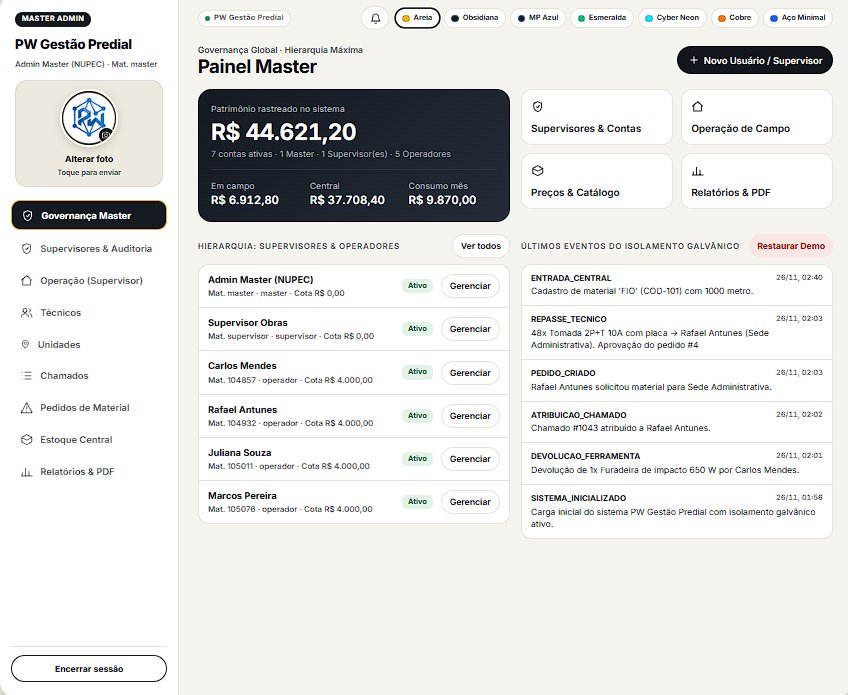
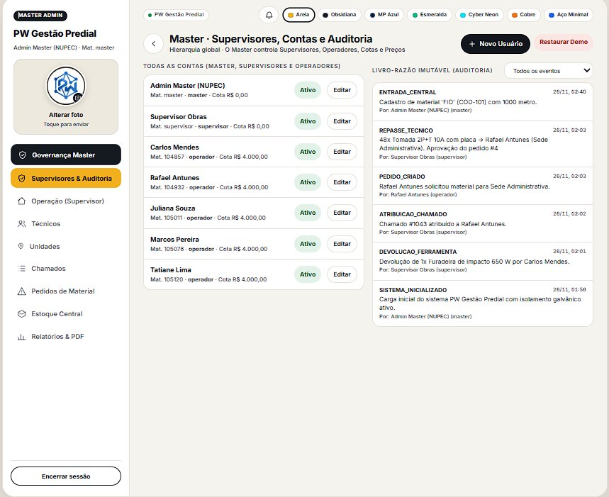
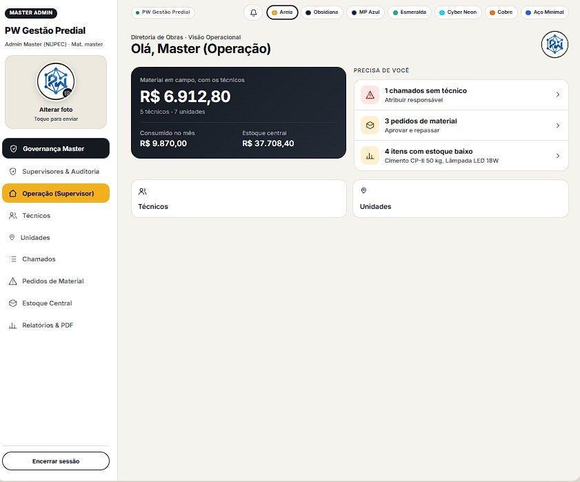
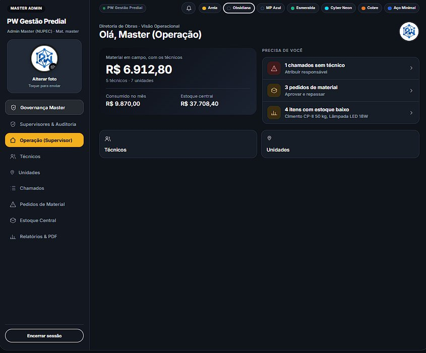

# PW Gestão Predial — Showcase

> Idioma / Language: **Português** · [English](README.en.md)

Plataforma corporativa da **PW System** para **Gestão Predial, Controle de Estoque em Campo, Custódia de Ferramental, Chamados de Manutenção e Auditoria Operacional** em operações multiunidade.

---

## Demonstração Ao Vivo (Web)

Acesse a aplicação web em ambiente de apresentação:

**[Abrir PW Gestão Predial no Render](https://pw-gestao-predial.onrender.com)**

> *Nota: por rodar em instância gratuita de demonstração, o primeiro acesso após inatividade pode levar alguns segundos para despertar o servidor.*

---

## Capturas do Sistema

### Painel Master — Governança Global e Auditoria
| Governança Global & Hierarquia | Supervisores, Contas e Livro-Razão |
| :---: | :---: |
|  |  |

### Visão Operacional — Temas Claro & Escuro
| Tema Areia | Tema Obsidiana (Dark Mode) |
| :---: | :---: |
|  |  |

### Relatório Mensal de Consumo (Exportação em PDF)

---

## Visão Geral dos Recursos

- **Controle por Níveis de Acesso:** separação estrita entre Administração Master, Supervisão Operacional e Técnicos de Campo.
- **Gestão de Estoque e Ferramental:** controle de estoque central, repasses com limite de cota, rastreio de custódia por técnico e histórico detalhado por item.
- **Fluxo Completo de Chamados:** abertura, atribuição por unidade/técnico, execução, baixa automática de materiais e notificações.
- **Auditoria Imutável:** registro histórico completo de movimentações financeiras e operacionais.
- **Relatórios Gerenciais em PDF:** consolidação mensal por técnico, por unidade e cruzamento unidade × técnico.
- **Interface Personalizável:** suporte a múltiplos temas visuais (modo claro, escuro e alto contraste) e foto de perfil por usuário.

---

## Propriedade Intelectual

Este repositório é exclusivamente uma vitrine de apresentação pública. O código-fonte completo e o aplicativo mobile nativo permanecem em repositórios privados sob propriedade da **PW System**.
